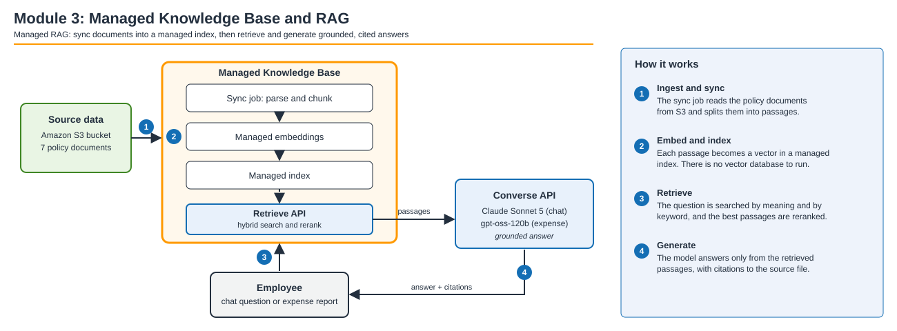
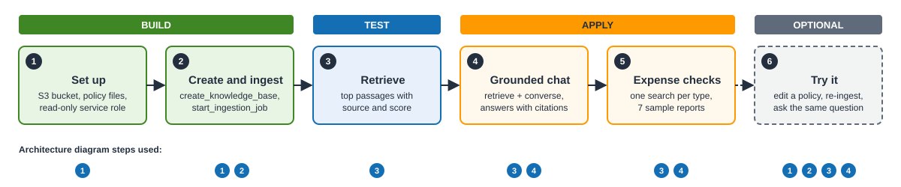

# Module 3: Managed Knowledge Base & RAG

Foundation models only know their training data: ask one about *AnyCompany's* travel policy and it
guesses. **Retrieval-Augmented Generation (RAG)** fixes that: retrieve the relevant passages from
your own documents and pass them to the model as grounding, so answers are accurate, current and
citable.

An **Amazon Bedrock Managed Knowledge Base** is *managed* RAG. Point it at documents in S3 and
Bedrock handles parsing, chunking, embedding, indexing, hybrid search and reranking. You pick no
embedding model and run no vector database. You create it with one API call and search it with the
`Retrieve` API.

## What changes for the assistant

Your travel assistant has two jobs, and both have the same gap: neither has read the policy.

| Job | Before this module | After this module |
|:--|:--|:--|
| **Travel chat** | In Module 1 it cannot tell an employee the nightly hotel limit in Chicago. | It answers from AnyCompany's policy ($250 in Chicago) and cites the source document. |
| **Expense checks** | In Module 2 the hand-typed rule ($250 a night everywhere) flags Marcus Chen's $320-a-night New York hotel. | The check retrieves the policy, which allows $325 in New York, and approves the report. |

## Time & cost

Notebook: [TODO: confirm after a full test run]. Ingestion, the longest wait, takes about 2 to 3
minutes.

> **Cost: read before you start**
>
> This module creates an S3 bucket, an IAM role, a Managed Knowledge Base and a data source in your
> account. They stay there until you run
> [99_cleanup.ipynb](../../notebooks/99_cleanup.ipynb), so run it when you finish the workshop.
> Model calls and knowledge base usage are billed. See
> [Amazon Bedrock pricing](https://aws.amazon.com/bedrock/pricing/).

## Architecture

A Managed Knowledge Base has two halves. **Ingestion and sync** (offline, when documents change)
reads S3, splits the documents into passages, creates embeddings and writes them to a managed
index. **Retrieve and generate** (online, per question) searches the index for the passages
closest to the question and hands them to a model, which answers from them with citations.

The notebook does both from code. The `bedrock-agent` client creates and syncs the knowledge base.
The `bedrock-agent-runtime` client's `retrieve` call searches it. The Converse API writes the
answer: Claude Sonnet 5 for chat and gpt-oss-120b for expense checks.

## Prerequisites

- Modules 0 to 2 complete. This module reuses the two model IDs you chose in Module 2.
- AWS credentials for `us-east-1` or `us-west-2` that can create an S3 bucket and an IAM role,
  create and ingest a knowledge base, and call Amazon Bedrock models.
- `notebooks/03_knowledge_base.ipynb` open in Jupyter.

## Sections

Run the notebook from top to bottom. Each section adds one capability. The blue badges under each
section are the steps of the architecture diagram it uses.

| # | Section | What you do | What you see | Diagram steps |
|:--|:--|:--|:--|:--|
| 1 | **Set up** | Create the clients, upload the seven policy documents to S3 and create a read-only service role for the knowledge base. | The Region, bucket and knowledge base names, the hotel policy text and the service role ARN. | 1 |
| 2 | **Create and ingest** | Make one `create_knowledge_base` call (`MANAGED` type and embeddings), connect the bucket as a data source, start an ingestion job and wait for it. | `Knowledge base ... is ACTIVE`, then the ingestion status and how many documents were indexed. | 1, 2 |
| 3 | **Retrieve** | Search the policy with `retrieve` for the Chicago hotel limit. | Passages ranked by relevance score, each with its source file. | 3 |
| 4 | **Grounded chat** | Combine `retrieve` with Converse. Ask three questions: the Chicago hotel limit, an overbooked hotel, and one the policy does not cover. | An answer with numbered citations such as `[1]`, followed by the cited source files. | 3, 4 |
| 5 | **Expense checks** | Run one `retrieve` per expense type, then check all seven sample reports. | For each report, a verdict, the expected verdict and a reason, then a count of reports that match the policy. Marcus's EXP-002 is the one that changes from Module 2. | 3, 4 |
| 6 | **Try it** (optional) | Change Chicago's hotel limit in the policy, upload it again and re-ingest. | The same question now returns the new limit, with no change to your code or prompts. | 1 to 4 |

## Next

Open `notebooks/03_knowledge_base.ipynb` and start with **Set up**. When you finish, continue to
Module 4, where you keep the grounded assistant safe and on-policy with Guardrails.

[Previous: Module 2 - Choosing a model](../../notebooks/02_choosing_a_model.ipynb) |
[Next: Module 4 - Guardrails](../../notebooks/04_guardrails.ipynb)
